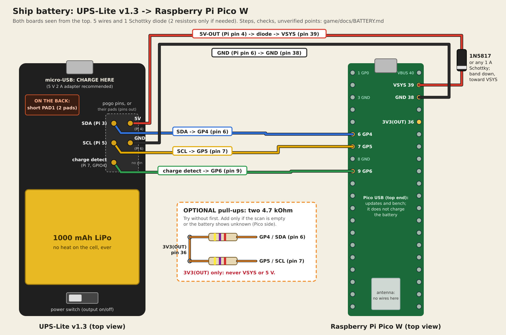

# The ship battery: wiring a UPS-Lite v1.3 to a Pico W

A ship can run off the shelf, away from a USB plug, on a **UPS-Lite v1.3**. It's a small
battery board made for the Raspberry Pi Zero, with a 1000 mAh LiPo cell, a charger, a 5 V
output and a CW2015 fuel gauge. It was designed to press onto a Pi Zero's pins with five
spring-loaded "pogo" pins. A Pico W has a different layout, so you solder **five wires and
one diode** between the two boards. Two pull-up resistors are optional (section 2). The
firmware (`board/lvbatt.py`) finds the gauge by itself, and the phones then show the charge
at the top of the ship's page.

The battery is optional. A board without one plays exactly as before.



Anything marked **[UNVERIFIED]** comes from the vendor's documents or photos and has not
been checked on a real board yet. Check those points with a multimeter before you trust
them (section 5).

## 1. What you need

| Item | Notes |
|---|---|
| UPS-Lite v1.3 | with its cell attached, as it comes |
| Pico W | running the game firmware (`docs/BENCH_TEST.md`) |
| 1 × 1N5817 Schottky diode | or another diode from the list in section 2 ("Which diode can I use") |
| Optional: 2 × 4.7 kΩ resistors | only if the battery isn't found without them (section 2). Bands: yellow, violet, red (then gold). Anything 2.2–10 kΩ works |
| Wire | stranded silicone wire is the easiest. See section 3 for gauges and colours |
| Optional: 1 × 100–220 µF electrolytic capacitor, 10 V or more | across VSYS and GND on the Pico. It helps if Wi-Fi makes the board reset (section 8) |
| Soldering iron (about 330 °C), thin rosin-core solder, flux pen | |
| Solder wick (braid) or a solder sucker, fine pliers or tweezers | for taking the pogo pins out (section 4) |
| Heat-shrink tube or electrical tape, wire stripper, flush cutters | |
| Kapton tape, or a strip of card | to shield the cell while you solder near it |
| Hot glue, or a small cable tie | strain relief for the wires (section 4) |
| Multimeter | needed for the checks in section 5 |
| A 5 V 2 A micro-USB phone charger | for charging the battery (section 6) |

**Safety**

- The LiPo cell is the only dangerous part. It sits right next to the pogo pins and
  can't be unplugged (its leads are soldered on). Cover it with Kapton tape or card while
  you work, never let the iron touch it, never bend or puncture it, and never short the
  board's 5 V or battery pads to GND.
- Turn the UPS-Lite's switch **off** while you solder. The cell still powers the board's
  gauge and charger, so a solder blob across pads can still cause a short.
- Unplug both USB cables while you solder.
- If the cell ever swells, gets hot or smells, stop using it.

## 2. The connections

The UPS-Lite's five pogo pins sit where the Pi Zero's header pins 3–7 would be. They keep
the Pi's pin numbers, and so do their pads once the pins are out (the vendor's schematic
calls the header P1). This guide calls them by those numbers. Pin 8 has no pogo pin.

| UPS-Lite pad / pogo pin (Pi pin) | Wire colour | Goes to on the Pico W | Notes |
|---|---|---|---|
| 5V-OUT (Pi pin 4) | red | **VSYS, pin 39** | through the diode, band (stripe) toward VSYS |
| GND (Pi pin 6) | black | **GND, pin 38** | any Pico GND works: pins 3, 8, 13, 18, 23, 28, 33, 38 |
| SDA (Pi pin 3) | blue | **GP4, pin 6** | the fuel gauge's I2C data line |
| SCL (Pi pin 5) | yellow | **GP5, pin 7** | the fuel gauge's I2C clock line |
| GPIO4 "charger plugged in" (Pi pin 7) | green | **GP6, pin 9** | only works with PAD1 shorted (below) |
| (optional) | 4.7 kΩ resistor | **3V3(OUT), pin 36** → GP4 pin 6 | only if needed: see "Pull-up resistors" |
| (optional) | 4.7 kΩ resistor | **3V3(OUT), pin 36** → GP5 pin 7 | only if needed |

Pico W pin numbers count from pin 1 (GP0), at the top left with the USB socket at the top
and the parts facing you, down the left side to pin 20, then up the right side from pin 21
to pin 40 (VBUS, top right). Pin 39 VSYS, 38 GND and 36 3V3(OUT) are near the top of the
right side. Pins 6, 7 and 9 are on the left side. The pin numbers are also printed on the
back of the Pico.

### Finding the pins (or their pads)

Hold the UPS-Lite with the **cell side down and the micro-USB socket at the top**, as in
the vendor's top-view photo. The five pins (or, once they're out, their five pads) are
beside the large round capacitor, in two columns: **[UNVERIFIED: from the vendor photo]**

```
            left column   right column
  row 1     SDA (3)       5V-OUT (4)
  row 2     SCL (5)       GND (6)
  row 3     GPIO4 (7)     (no pin)
```

So the pin (or pad) on its own, at the bottom, is the charger line. The one above it is
SCL, and the one above that is SDA. In the other column, the one beside SCL is GND and
the one beside SDA is 5V-OUT. **Never rely on the picture alone. Prove 5V-OUT, GND and
the charger line with the multimeter (section 5, checks A–D) before you solder anything
to them.** SDA and SCL can't be told apart with a meter. If the gauge isn't found, swap
those two wires; a swap does no harm.

### PAD1: turning on the "charger plugged in" signal

On the back of the UPS-Lite are two small pads that must be shorted for the "power
plugged in" signal. The vendor's schematic calls them **PAD1**. Join them with a blob of
solder (or a short scrap of wire). Without this, the vendor says the signal is "unstable",
so the bolt may flicker or never show. The battery percentage still works either way.
**[UNVERIFIED: their exact position on v1.3; the vendor's notes show them in a photo of
the back.]**

### The diode: why it's needed

The Pico W already has a diode between its USB socket and VSYS, which stops the battery
pushing current back into your laptop. The extra diode stops the opposite: **the laptop's
USB 5 V pushing into the UPS-Lite's 5 V output** when both are connected. The Pico W
datasheet ("Powering Pico W") says to add a second supply this way, and the higher of the
two then powers the board.

You could only skip it if the Pico's USB socket were never used while the UPS-Lite is
connected: the datasheet allows feeding VSYS directly "if the USB port is not going to be
used". The game uses the Pico's USB for updates and the bench, so **keep the diode**.

- Solder the diode **in the red wire**, close to the Pico: the end **without** the stripe
  toward the UPS-Lite, the end **with the stripe (band)** at VSYS pin 39.
- Wrong way round, nothing is damaged, but the Pico won't run from the battery.
- The Pico W runs on anything from 1.8 to 5.5 V at VSYS, so the diode's drop is no
  problem.

### Which diode can I use

Whichever type you use, the **stripe (band) goes toward VSYS**.

| | Diode | Rating (datasheet) | Drop at the Pico's current | VSYS from 5 V |
|---|---|---|---|---|
| **Best** | **1N5817**, 1N5818, 1N5819 (Schottky) | 1 A; 20 / 30 / 40 V | ≤ 0.32–0.34 V at 0.1 A (≤ 0.45–0.6 V at 1 A) | about 4.7 V |
| **Best** | SS14 (Schottky, surface mount) | 1 A, 40 V | ≤ 0.5 V at 1 A | about 4.6–4.7 V |
| **Best** | SS34, 1N5822 (Schottky) | 3 A, 40 V | ≤ 0.5 V (SS34) / 0.525 V (1N5822) at 3 A | about 4.6–4.7 V |
| **OK** | 1N4001 … 1N4007 (ordinary rectifier) | 1 A, 50–1000 V | about 0.7–0.8 V (≤ 1.0 V at 1 A) | about 4.2 V: still well inside 1.8–5.5 V, but a little more of the battery is lost as heat |
| **Don't use** | 1N4148 or other small-signal diodes | 150 mA average | | too small for the Pico W with Wi-Fi on |
| **Don't use** | Zener diodes, LEDs | | | not made for this: a Zener is meant to conduct backwards at its voltage, and an LED drops 2 V or more and takes only about 20 mA |

Any Schottky rated 1 A or more and 20 V or more works. The table's figures come from the
onsemi 1N5817–1N5819, Vishay SS12–SS16, SS32–SS36 and 1N5820–1N5822, Diodes Inc.
1N4001–1N4007 and Vishay 1N4148 datasheets. The 1N400x drop at about 0.1 A is read from
its typical curve, not a guaranteed figure.

### Pull-up resistors: try without them first

I2C needs both lines pulled up to 3.3 V. On a Raspberry Pi, the Pi itself has 1.8 kΩ
pull-ups on these pins. The UPS-Lite's published schematic wires the gauge's SDA and SCL
straight to the Pi's pins with **no pull-ups of its own**, as it doesn't need any there.
So assume the v1.3 board has none either (section 5, check E, shows it).

The game firmware switches on the Pico's **internal** pull-ups and runs the bus slowly
(50 kHz, dropping to 10 kHz if the gauge doesn't answer), which suits weak pull-ups on
short wires. So:

1. **Wire it without resistors** and do the first power-up test (section 7).
2. Only if the scan prints `[]` (after swapping SDA/SCL once), or the battery keeps
   showing "unknown", add the two 4.7 kΩ resistors:
   - one from GP4 (pin 6) to 3V3(OUT) (pin 36);
   - the other from GP5 (pin 7) to 3V3(OUT) (pin 36).
   - The easy way: bend the resistor legs so one leg of each sits on the pin 6 / pin 7 pad
     with the signal wire, twist their other two legs together, and run one short wire
     from that joint to pin 36. Cover the bare legs with heat-shrink.
   - **Pull-ups go to 3V3(OUT) only. Never to VSYS or 5 V**: the Pico's pins take 3.3 V.

The resistors never hurt, so add them anyway if you're already soldering at the Pico
and want the most margin.

## 3. Wire

| Wire | Colour | Gauge |
|---|---|---|
| 5V-OUT → diode → VSYS | red | 24 AWG (thicker is fine) |
| GND → GND | black | 24 AWG |
| SDA → GP4 | blue | 26–28 AWG |
| SCL → GP5 | yellow | 26–28 AWG |
| GPIO4 → GP6 | green | 26–28 AWG |

- Keep every wire short: **10 cm or less**, just long enough to lay the boards side by
  side or back to back in the case. With no pull-up resistors, short SDA/SCL wires
  matter most.
- Keep SDA and SCL beside the GND wire, loosely twisted if they're longer than a few cm.
- Keep wires and the battery away from the Pico W's **antenna**: the end of the board
  opposite the USB socket. Metal there costs Bluetooth and Wi-Fi range.
- Colours are only a suggestion, but red/black for power avoids mistakes.

## 4. Soldering, step by step

1. **Check the UPS-Lite first (section 5, checks A–E)** with the pogo pins still in and
   nothing soldered. Mark 5V-OUT, GND and the charger pin with a marker on the board.
2. **PAD1**: solder the two PAD1 pads together on the UPS-Lite's back.
3. **Shield the cell** with Kapton tape or a strip of card.
4. **The UPS-Lite end.** Choose one of these:

   **A. Remove the pogo pins and solder to their pads (smallest).**
   The pins are through-hole parts, soldered on the board's back. **[UNVERIFIED: from the
   vendor photos.]**
   - Easiest and safest: **cut each pin off with flush cutters**, about 1 mm above the
     board, then solder the wire to that stub. The pin's own joint stays untouched and
     the pad can't lift.
   - Or take them out completely: add a little fresh solder to the pin's joint on the
     back, heat it, and pull the pin out from the top with pliers. Then clear the hole
     with solder wick or a solder sucker. One pin at a time, 3–4 s of heat at most, and
     let the board cool between pins. If a pin won't move, stop and cut it off instead:
     forcing it tears the pad off the board.
   - With the hole clear, push the tinned wire through from the top and solder it on
     the back (the strongest joint), or solder the wire flat onto the pad.
   - Check there's no solder bridge between neighbouring pads. They're 2.54 mm apart.

   **B. Leave the pins in and solder to their barrels.**
   Solder each wire to the **side or base (the barrel) of its pogo pin, never to the
   moving tip (the plunger)**: solder on the plunger jams it. Be quick (2–3 s).
   **[UNVERIFIED: whether the barrels take solder well; use flux.]**

   Either way: strip 3 mm and tin each wire end first, and keep the iron well away from
   the cell.
5. **Strain relief.** A thin wire soldered to a small pad breaks at the joint if it gets
   bent. Put a dab of hot glue over the five wires about 5 mm from the pads (not on the
   cell). Or tie them to a mounting hole or standoff with a small cable tie or thread, so
   a tug on the wires pulls on the tie, not the joints. Leave a little slack and run the
   wires flat along the board.
6. **Pico side, signals.** Solder the blue wire to pin 6 (GP4), yellow to pin 7 (GP5),
   green to pin 9 (GP6). If the Pico has header pins, solder to them, or use female
   jumper housings.
7. **Diode.** Solder the red wire to the diode's plain end, and the striped end to pin 39
   (VSYS). Cover the diode and joints with heat-shrink.
8. **GND.** Black wire to pin 38.
9. **Optional capacitor**: + leg (the longer one; the stripe marks −) to VSYS pin 39, −
   leg to GND pin 38.
10. **No resistors yet** (section 2, "Pull-up resistors").
11. Look over every joint: shiny, no blobs bridging to the next pin, no stray strands.
12. Do checks F–H (section 5) **before** turning the switch on.

## 5. Multimeter checks

Set the meter to DC volts (20 V range) or continuity (the beep). Checks A–E are on the
UPS-Lite alone, before anything is connected (with the pins in, or on the pads once
they're out).

| Check | How | Expect |
|---|---|---|
| A. 5V-OUT | UPS-Lite switch **on**: black probe on the micro-USB socket's metal shell, red on the pin/pad you think is 5V-OUT | about **5.0 V** (4.8–5.2). Switch off: about 0 V |
| B. GND | continuity between the GND pin/pad and the micro-USB socket's metal shell | beep |
| C. Charger line | PAD1 shorted, charger plugged into the UPS-Lite, black on GND, red on the Pi-pin-7 pin/pad | about **3.3 V** (the vendor's 39k/75k divider from 5 V); charger unplugged: about 0 V |
| D. No other 5 V | switch on, black on GND: the SDA and SCL pins/pads | **under 3.6 V** (near 0 V is normal) |
| E. Pull-ups on the board? | same as D | near 0 V or wandering: **no pull-ups on the board** (expected, section 2). A steady 3–3.3 V: the board has its own pull-ups. **More than 3.6 V: don't connect SDA/SCL to the Pico** before asking |
| F. No shorts | switch **off**, nothing plugged in: continuity VSYS (pin 39) to GND (pin 38), and 3V3(OUT) (pin 36) to GND | **no** beep (a short beep that stops is the capacitor charging, that's OK) |
| G. Diode | diode mode, red probe on the UPS-Lite's 5V-OUT pad, black on Pico pin 39 | 0.15–0.4 for a Schottky, 0.5–0.7 for a 1N400x; reversed: nothing |
| H. If fitted, pull-ups | resistance from pin 6 to pin 36, and from pin 7 to pin 36 | about 4.7 kΩ each |
| I. Powered | switch **on**, no USB: black on pin 38, red on pin 39 / pin 36 | about 4.6–4.8 V (4.2 V with a 1N400x) / 3.3 V |
| J. Charger line at the Pico | charger in the UPS-Lite: pin 9 (GP6) to GND, with the game running | about 2–3.3 V plugged in, about 0 V unplugged |

If check A or B finds 5 V or GND on a different pad from the picture, trust the meter and
rework the table in section 2 before soldering.

## 6. Charging, and the power switch

- **Charge through the UPS-Lite's own micro-USB socket**, with a 5 V 2 A phone charger
  (the vendor recommends 2 A). The board keeps running while it charges.
- **The Pico W's USB socket does not charge the battery.** The diode stops current going
  back toward the UPS-Lite. Use the Pico's USB for updates and the bench, as before.
- The UPS-Lite's light: **red** while charging, **green** when full.
- The **switch** on the UPS-Lite turns its 5 V output on and off. Off, the Pico runs only
  if its own USB is plugged in. The gauge stays powered by the cell either way.
- Rough numbers, **[UNVERIFIED estimates, not measured]**: a full charge takes about 3
  hours (the charger gives up to 400 mA); a Pico W with Wi-Fi and Bluetooth on uses about
  60–100 mA, so a full battery should last very roughly 7–8 hours. Check the real number
  on your board and note it here.
- The cell's protection cuts the output at about 2.7 V. The gauge reads about 1% near
  3.5 V. Charge it when the phone says to (under 15%); storing it flat for weeks harms
  it.

## 7. First power-up test

You need `mpremote` on a computer (`pip install mpremote`) and the board on USB. Turn the
UPS-Lite switch on.

1. **Is the gauge there?** It should answer at address 0x62. This uses the Pico's
   internal pull-ups at 50 kHz, as the game does:

   ```sh
   mpremote exec "from machine import I2C, Pin; print([hex(a) for a in I2C(0, sda=Pin(4, Pin.IN, Pin.PULL_UP), scl=Pin(5, Pin.IN, Pin.PULL_UP), freq=50000).scan()])"
   ```

   Expect `['0x62']`. If you get `[]`, try `freq=10000`. Still `[]`: swap the SDA and
   SCL wires and try again. Still nothing: section 8, "Not detected".

2. **A raw reading** (wakes the gauge if it's asleep, waits 2 s, then prints the cell
   voltage, the percent and the charger line):

   ```sh
   mpremote exec "
   from machine import I2C, Pin
   import time
   u = Pin.PULL_UP
   i = I2C(0, sda=Pin(4, Pin.IN, u), scl=Pin(5, Pin.IN, u), freq=50000)
   if i.readfrom_mem(0x62, 0x0A, 1)[0] & 0xC0: i.writeto_mem(0x62, 0x0A, b'\x30')
   time.sleep(2)
   v = i.readfrom_mem(0x62, 2, 2); s = i.readfrom_mem(0x62, 4, 2)
   print('mV', ((v[0] & 0x3F) << 8 | v[1]) * 305 // 1000, 'percent', s[0], 'plugged in', Pin(6, Pin.IN, Pin.PULL_DOWN).value())
   "
   ```

   Expect something like `mV 3950 percent 72 plugged in 1` (between 3500 and 4200 mV;
   `plugged in` is 1 with the charger in the UPS-Lite's socket, 0 without). Run it a few
   times: the same numbers every time means the bus is solid without resistors. Then
   `mpremote reset` to start the game again.

3. **The game's own check.** Run the bench (`docs/BENCH_TEST.md`, fast path). Its report
   gets a `battery` row, and the self-test prints:

   ```
   SELFTEST battery: detected, 72%, 3950 mV, charging yes
   ```

   The board's console also says `battery: gauge found at 0x62, I2C 50 kHz` at boot
   (`10 kHz` if it needed the slower speed). The row is always INFO: a missing battery
   never fails the bench.

4. **On a phone**, join the ship's hotspot and open the game: a battery mark with the
   percent at the top of the page, with a bolt while it charges.

5. **Unplug the Pico's USB.** The board should keep running on the battery (the hotspot
   stays up).

## 8. Troubleshooting

**The phone / self-test says 0%, or "reading unknown"**

- Just after the gauge wakes (first power-up, or after the cell was disconnected), it
  needs a few seconds to estimate. The firmware tries again after 5 s. Wait a minute.
- Check the raw reading (section 7, step 2). If `mV` is about 3500 or lower, the cell
  really is flat: charge it.
- `mV` near 0: the gauge has no power. The cell is disconnected, or the protection has
  tripped after a deep discharge. Plug the charger into the UPS-Lite for a while to wake
  the protection.
- "Unknown" that comes and goes: the bus is marginal. Fit the two 4.7 kΩ resistors
  (section 2) and keep SDA/SCL short.
- The percent is the gauge's own estimate from its built-in cell profile, and can be off
  by a few percent on this cell **[UNVERIFIED]**. The voltage is the honest number.

**"none detected" / the scan prints `[]`**

- SDA and SCL swapped: swap the blue and yellow wires at the Pico end.
- The internal pull-ups aren't enough: fit the two 4.7 kΩ resistors (section 2).
- No common ground: check the black wire (check B and continuity to Pico pin 38).
- A cold joint, or a pad lifted while taking a pogo pin out: re-flow any dull or lumpy
  joint, check continuity from the wire to the pad's trace, and wiggle each wire while
  scanning.
- The UPS-Lite's switch is off **and** the cell is flat.
- Wrong pins in software: the game expects GP4/GP5. Other pins: set `bat_sda` and
  `bat_scl` in `/data/ship.json` (section 9).
- Still nothing: put `"battery": true` in `ship.json`. The phone then shows the battery as
  unknown, which at least confirms the firmware side.

**The bolt never shows while charging**

- PAD1 isn't shorted (section 2), or check C fails.
- The green wire isn't on GP6 (pin 9), or check J fails.
- The vendor's notes use the pin as a floating input; this firmware adds a pull-down by
  default so an unconnected pin reads "not charging". If the line reads 1 all the time,
  set `"bat_chg_pull": "none"` in `ship.json` (section 9). **[UNVERIFIED: the signal
  level on v1.3 with the Pico's pull-down; about 2.2–2.5 V expected when plugged in,
  enough for a "1".]**

**The board resets or drops when Wi-Fi starts (on battery only)**

- Wi-Fi draws short current bursts, and thin or long wires drop the voltage. Use 24 AWG
  red and black, keep them short, and check the joints.
- A cracked joint at the UPS-Lite's pads: redo it and add the strain relief (section 4).
- Add the 100–220 µF capacitor across VSYS and GND (section 1).
- Check the diode is one from the "Best" or "OK" rows in section 2, not a 1N4148.
- The percent on the phone won't jump about during bursts: the firmware smooths the
  voltage and only reads while the radio is idle.

## 9. Settings (all optional, `/data/ship.json`)

| Key | Default | Meaning |
|---|---|---|
| `battery` | `"auto"` | `"auto"` looks once at boot; `true` always shows the battery (unknown if missing); `false` never looks |
| `bat_sda`, `bat_scl` | `4`, `5` | the I2C pins (GP numbers) |
| `bat_i2c` | `0` | the RP2040 I2C block for those pins |
| `bat_khz` | (none) | I2C speed in kHz. Unset: 50, and 10 if the gauge doesn't answer at 50 (or after 3 failed readings). With resistors fitted, 100 is fine |
| `bat_chg` | `6` | the charger-detect GP number; `-1` for none |
| `bat_chg_pull` | `"down"` | `"down"`, `"up"` or `"none"` on that pin |
| `bat_every_s` | `60` | seconds between readings (5 at least) |

## Sources

- UPS-Lite v1.3 instructions and example script (vendor repository
  `linshuqin329/UPS-Lite` on GitHub, folder `UPS-Lite_V1.3_CW2015`): pogo pins on Pi pins
  3–7, charge-detect on GPIO4 with the two back pads shorted, CW2015 at address 0x62, the
  5 V 2 A charger, the LED colours, the 1000 mAh cell, 400 mA charging.
- The vendor's schematic (in the UPS-Lite instructions; drawn for v1.2 with a MAX17040G
  gauge): SDA/SCL go straight from the gauge to the Pi's pins 3 and 5 with no pull-ups;
  PAD1 and the 39k/75k divider on the charge-detect line; header P1 pins 3–7.
- Raspberry Pi, "Using I2C on Raspberry Pi SBCs" (white paper): every Pi has 1.8 kΩ
  pull-ups on GPIO 2 and 3.
- Cellwise CW2015 datasheet: the registers the firmware reads (VERSION 0x00, VCELL
  0x02–03 at 305 µV per step, SOC 0x04–05, MODE 0x0A); SDA/SCL open drain, input high
  1.4 V; 4.7 kΩ pull-ups in its application circuit.
- Raspberry Pi Pico W datasheet, "Powering Pico W": VSYS 1.8–5.5 V, D1 between VBUS and
  VSYS, a Schottky diode for a second supply, VSYS fed directly only if the USB port is
  not used; the pinout.
- RP2040 internal pull-ups of about 50–80 kΩ (Adafruit, CircuitPython pull request #4488),
  and Klipper pull request #5710, which runs RP2040 I2C on the internal pull-ups alone.
- MicroPython `ports/rp2/machine_i2c.c` (v1.29.0): `machine.I2C` turns the internal
  pull-ups on for its SDA/SCL pins.
- Diode datasheets: onsemi 1N5817–1N5819, Vishay SS12–SS16, SS32–SS36, 1N5820–1N5822 and
  1N4148, Diodes Inc. 1N4001–1N4007.

## What has not been checked yet

- The pin/pad order on a real v1.3 board (from the photo only): checks A–D settle it.
- That v1.3 has no I2C pull-ups of its own (the schematic is v1.2's): check E settles
  it.
- That the gauge answers reliably with only the Pico's internal pull-ups.
- That the pogo pins are through-hole and come out cleanly, and whether their barrels
  take solder.
- The PAD1 pads' exact position on v1.3.
- The GP6 voltage with the pull-down fitted.
- Charge time, run time and how accurate the percent is on this cell.
- **None of this has been tried on hardware yet.** The firmware was tested against a
  simulated gauge only. Please note what you find here.
